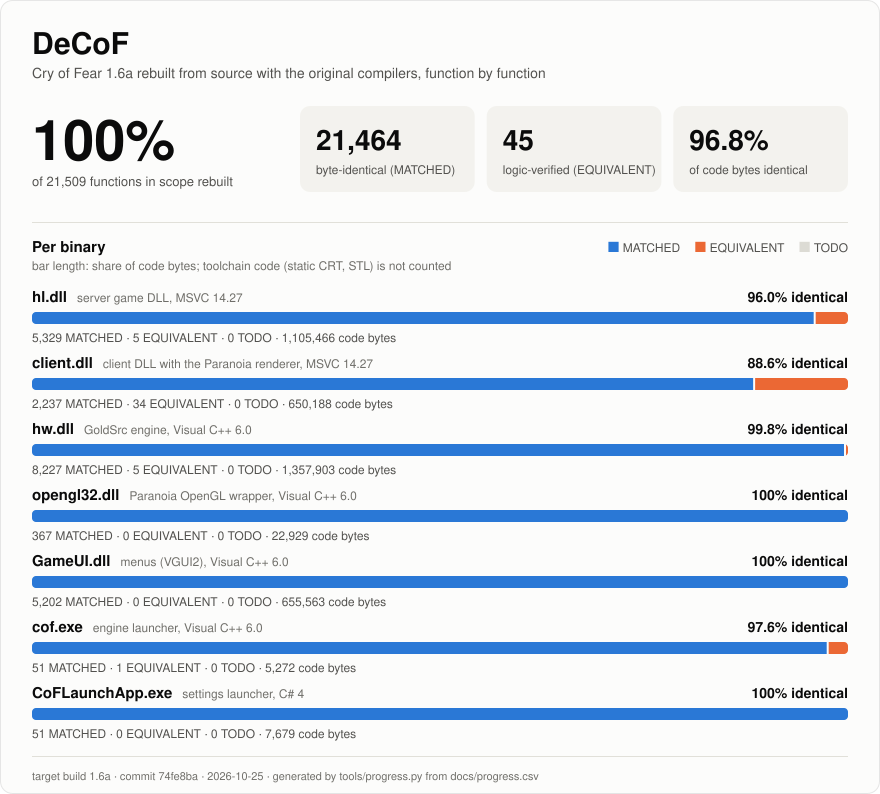

# Progress

Generated by `tools/progress.py` from `docs/progress.csv`. Do not edit by hand.

Target build 1.6a, commit 74fe8ba, 2026-10-25.

## hl.dll

| Category | Matched | Equivalent | Total | Percent |
|---|---:|---:|---:|---:|
| HLSDK | 2472 | 3 | 2475 | 100.0% |
| PARANOIA | 82 | 0 | 82 | 100.0% |
| SPIRIT | 409 | 0 | 409 | 100.0% |
| COF | 1788 | 2 | 1790 | 100.0% |
| UNKNOWN | 578 | 0 | 578 | 100.0% |
| **All** | **5329** | **5** | **5334** | **100.0%** |

## client.dll

| Category | Matched | Equivalent | Total | Percent |
|---|---:|---:|---:|---:|
| HLSDK | 643 | 3 | 646 | 100.0% |
| PARANOIA | 264 | 1 | 265 | 100.0% |
| SPIRIT | 19 | 0 | 19 | 100.0% |
| COF | 366 | 14 | 380 | 100.0% |
| UNKNOWN | 945 | 16 | 961 | 100.0% |
| **All** | **2237** | **34** | **2271** | **100.0%** |

## hw.dll

| Category | Matched | Equivalent | Total | Percent |
|---|---:|---:|---:|---:|
| ENGINE | 5455 | 5 | 5460 | 100.0% |
| UNKNOWN | 2772 | 0 | 2772 | 100.0% |
| **All** | **8227** | **5** | **8232** | **100.0%** |

## opengl32.dll

| Category | Matched | Equivalent | Total | Percent |
|---|---:|---:|---:|---:|
| PARANOIA | 367 | 0 | 367 | 100.0% |
| **All** | **367** | **0** | **367** | **100.0%** |

## GameUI.dll

| Category | Matched | Equivalent | Total | Percent |
|---|---:|---:|---:|---:|
| ENGINE | 397 | 0 | 397 | 100.0% |
| UNKNOWN | 4805 | 0 | 4805 | 100.0% |
| **All** | **5202** | **0** | **5202** | **100.0%** |

## cof.exe

| Category | Matched | Equivalent | Total | Percent |
|---|---:|---:|---:|---:|
| ENGINE | 51 | 1 | 52 | 100.0% |
| **All** | **51** | **1** | **52** | **100.0%** |

## CoFLaunchApp.exe

| Category | Matched | Equivalent | Total | Percent |
|---|---:|---:|---:|---:|
| COF | 51 | 0 | 51 | 100.0% |
| **All** | **51** | **0** | **51** | **100.0%** |

## Counting rules

- **MATCHED**: the objdiff report gives 100 percent for the function: the instructions are identical to the retail binary. The report does not compare the names of relocation targets (many retail symbols are still unnamed); `tools/relocaudit.py` lists matched functions whose relocations point at differently named symbols.
- **EQUIVALENT**: the function compiles and its logic was verified against the assembly, but the code is not byte identical. The remaining difference is recorded in `docs/progress.csv`.
- **TODO**: every other function, including stubs and functions that do not compile.
- Rows of class LIB (static CRT, STL instantiations and compiler generated helpers from the toolchain) are not decompiled and are left out of every figure.
- Matched, Equivalent and Total in the tables are function counts. Percent is (MATCHED + EQUIVALENT) code bytes over all code bytes of the row; each function weighs its size in the retail binary.
- The SVG bars use the same byte weighting; the function counts are shown next to them.
